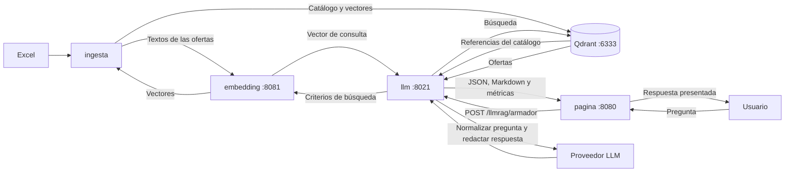

# CarreRAGs

Proyecto de consulta de ofertas educativas de Argentina. Publica un catálogo
en Qdrant y expone una API que interpreta la pregunta del usuario, recupera
ofertas y redacta una respuesta en castellano rioplatense con formato Markdown.

El flujo completo utiliza **`pagina`, `llm`, `ingesta` y `embedding`**, además
de Qdrant y el proveedor LLM configurado. La API también puede consultarse
directamente sin la página. Cada componente tiene su propia guía:

| Componente | Responsabilidad | Ejecución |
|---|---|---|
| [embedding](embedding/README.md) | Genera vectores con el modelo compartido por la publicación y las búsquedas. | Servicio HTTP en el puerto **8081**, desplegado en Docker Linux ARM64 para el Mac mini. |
| [ingesta](ingesta/README.md) | Lee el Excel, valida y normaliza las ofertas, genera sus vectores y publica el catálogo en Qdrant. | `python run.py` al cargar o actualizar el catálogo. |
| [llm](llm/README.md) | Normaliza preguntas con una LLM, busca ofertas y hace otra llamada a la LLM para redactar la respuesta. | API FastAPI/Uvicorn en el puerto **8021**; contenedor **`carrerags-api`**. |
| [pagina](pagina/README.md) | Interfaz Flask con chat, proxy de consultas y presentación de Markdown saneado. | Puerto **8080**; contenedor **`carrerags-pagina`**. |

Qdrant almacena vectores y datos de las ofertas; su API HTTP usa el puerto
**6333** en los ejemplos. Debe instalarse y arrancarse por separado: los
instaladores de `embedding` y `llm` no lo despliegan.
El código actual del router selecciona Qwen/Ollama mediante
`llm/helpers/llm_qewn.py`. Phi (`llm/helpers/llm_phi.py`) y OpenAI
siguen disponibles como conectores alternativos.

## Flujo de publicación y consulta



La publicación incluye todas las ofertas activas, con sus modalidades y
requisitos. Los metadatos de elegibilidad del perfil original se conservan
sin excluir esas ofertas del índice.

Una consulta a la API sigue estos pasos:

1. Lee de Qdrant los títulos, niveles, instituciones, ubicaciones y modalidades
   para dar contexto a la primera llamada a la LLM.
2. Normaliza la pregunta a cinco filtros: `carrera`, `nivel_educativo`,
   `institucion`, `ubicacion` y `modalidad`. Lo no especificado queda en `null`.
3. Genera el vector de búsqueda mediante `embedding` y recupera ofertas de Qdrant.
4. Envía las ofertas recuperadas y la pregunta original a una segunda llamada
   a la LLM, que redacta la respuesta usando los datos y enlaces recibidos.
5. Devuelve un JSON con la pregunta, los filtros, la respuesta, el consumo de
   tokens y el rendimiento; guarda la salida completa en un archivo JSON.
   La página presenta el Markdown y conserva las métricas en el JSON del proxy.

`embedding` usa el modelo
`sentence-transformers/paraphrase-multilingual-MiniLM-L12-v2`, revisión
`e8f8c211226b894fcb81acc59f3b34ba3efd5f42`, con vectores normalizados de
**384 dimensiones**. La publicación y la consulta deben usar el mismo espacio
vectorial. El modelo que interpreta y redacta respuestas se configura por separado.

## Configuración de cada instalación

Crear los archivos **`ingesta/.env`**, **`llm/.env`** y **`pagina/.env`** en sus
componentes. Un archivo en la raíz no sustituye los archivos de cada componente.
Los README enumeran únicamente los nombres de las variables.

| Archivo que debe crearse | Nombres de variables |
|---|---|
| `ingesta/.env` | `VECTORIAL`, `VECTORIAL_PROVIDER`, `VECTORIAL_NAMESPACE`, `VECTORIAL_API_KEY`, `EXCEL`, `INGESTA_MODO`, `INGESTA_ESTADO`, `EMBEDDING_PROVIDER`, `EMBEDDING_URL`, `EMBEDDING_MODEL`, `EMBEDDING_REVISION`, `EMBEDDING_DIMENSIONS`, `HTTP_TIMEOUT`. |
| `llm/.env` | Comunes: `VECTORIAL`, `VECTORIAL_NAMESPACE`, `EMBEDDING_URL`, `HTTP_TIMEOUT`. Qwen: `LLM_QWEN`, `LLM_QWEN_MODELO`. Phi: `LLM_PHI`, `LLM_PHI_MODELO`. OpenAI: `API_KEY_LLM`, `MODELO`. |
| `pagina/.env` | `URL_API`. |

`embedding` no requiere un archivo de entorno. Ver las listas en los README de
[ingesta](ingesta/README.md#configuración), [llm](llm/README.md#configuración) y
[pagina](pagina/README.md#configuración).

La selección del conector generativo se hace mediante el import de
`llm/routers/llmrag.py`. Ver la
[selección del conector](llm/README.md#selección-del-conector-llm).

Crear `llm/.env` también en la máquina que construye la imagen. Después de
cambiar la configuración, reconstruir la imagen y recrear el contenedor.

## Orden de instalación y arranque

### 1. Preparar Qdrant

Iniciar Qdrant y configurar su dirección y colección en ambos clientes. La
ingesta debe poder crear, escribir y eliminar la colección. La API actual no
implementa autenticación mediante API key de Qdrant.

### 2. Iniciar embedding

En el Mac mini Apple Silicon, con Docker Desktop iniciado, desde la raíz:

```bash
bash embedding/install.sh
curl --fail-with-body http://localhost:8081/health
```

La primera construcción descarga dependencias y pesos. Durante la ejecución
el modelo usa archivos locales. Las opciones de reconstrucción y uso sin red
están en el [README de embedding](embedding/README.md).

### 3. Publicar con ingesta

Con Python 3.10 o posterior, un entorno virtual activado, `ingesta/.env`
creado y el Excel de entrada disponible:

```bash
cd ingesta
python -m pip install -r reqs-http.txt
python run.py
```

Se selecciona el único `.xlsx` de `ingesta`; si hay varios o está en otra
ubicación, definir `EXCEL`. `python run.py` no necesita argumentos.
Las instrucciones de activación, todas las variables y el formato del Excel
están en el [README de ingesta](ingesta/README.md).

La publicación reemplaza la colección configurada. Durante la reconstrucción
el catálogo puede quedar temporalmente indisponible; una carga fallida puede
dejarlo ausente o incompleto y requiere corregir la causa y repetir la ingesta.
Conservar el estado local de ingesta para el historial y la caché.

### 4. Iniciar llm

Con `llm/.env` preparado, en el equipo que despliega y desde la raíz:

```bash
bash llm/install.sh
```

El script construye la imagen, recrea **`carrerags-api`**, publica **8021** y
comprueba que la API responde. Ese healthcheck no verifica las conexiones a
Qdrant, embeddings o el proveedor LLM seleccionado.

Para desarrollo local, con el entorno virtual activado y desde `llm`:

```console
python -m pip install -r requirements.txt
uvicorn main:app --host 127.0.0.1 --port 8021 --reload --log-config log_config.json
```

Para consultar, mantener disponibles `llm`, `embedding`, Qdrant y el proveedor
LLM. La ingesta solo se vuelve a ejecutar cuando se quiere publicar el catálogo.

### 5. Iniciar pagina

Con `pagina/.env` disponible en el Mac o servidor, desde la raíz:

```bash
bash pagina/install.sh
```

El instalador construye la imagen, recrea el servicio, espera su healthcheck,
verifica el nombre **`carrerags-pagina`** y consulta `/health` por el puerto
publicado, **8080** por defecto. La página queda en `http://macmini:8080/`
si `macmini` es el nombre de ese servidor.

La página debe poder alcanzar la API desde su contenedor. Su archivo
`pagina/.env` debe incluir `URL_API`.

La página envía con el botón o **Enter**; **Shift+Enter** inserta una nueva línea.
Durante la consulta bloquea nuevos envíos. El historial vive en memoria en la
pestaña. Cada pregunta es independiente y no se envía una conversación completa.
Ver [configuración, despliegue y pruebas de pagina](pagina/README.md).

Para actualizar después de subir los cambios al repositorio, en el Mac:

```bash
cd ~/carrerags
git pull
bash llm/install.sh
bash pagina/install.sh
```

Recrear los componentes que hayan cambiado. Los healthchecks verifican el
servicio correspondiente, no una consulta completa con todos sus proveedores.

## Ollama: entorno LLM local en el Mac mini

Las notas de [LLM.md](LLM.md) describen un **Mac mini M4 con 16 GB de RAM y
macOS**, con Ollama instalado de forma nativa mediante Homebrew y Qwen 3.5 2B
en cuantización Q4_K_M (`qwen3.5:2b-q4_K_M`). Ollama utiliza la GPU Apple Silicon
mediante Metal y se ejecuta fuera de Docker. Su API local es
`http://localhost:11434` y los modelos se almacenan por defecto en
`~/.ollama/models`. La versión comprobada en las notas es **Ollama 0.40.11**,
con motor llama.cpp y aproximadamente **1,6 GB** de memoria observada para el
modelo cargado; ese valor no es un límite para otros contextos o consultas.
El acceso HTTP desde Windows a **`http://macmini:11434`** figura como comprobado
en `LLM.md`.

La guía completa está integrada en el
[README de llm](llm/README.md#ollama-llm-local-en-mac-mini-m4). Los comandos
principales, para ejecutar en el Mac, son:

| Acción | Comando |
|---|---|
| Instalar Ollama | `brew install ollama` |
| Ver la versión instalada | `ollama --version` |
| Encender manualmente | `brew services run ollama` |
| Ver el estado del servicio | `brew services list` |
| Comprobar la API encendida | `curl --connect-timeout 5 http://localhost:11434/api/version` |
| Descargar el modelo la primera vez | `ollama pull qwen3.5:2b-q4_K_M` |
| Listar modelos instalados | `ollama list` |
| Abrir el chat interactivo | `ollama run qwen3.5:2b-q4_K_M` |
| Salir del chat | `/bye` |
| Ver modelos cargados en RAM/GPU | `ollama ps` |
| Liberar la memoria del modelo sin apagar el servidor | `ollama stop qwen3.5:2b-q4_K_M` |
| Apagar el servicio completo | `brew services stop ollama` |
| Comprobar que dejó de responder | `curl --connect-timeout 3 http://localhost:11434/api/version` |

El último comando debe fallar por conexión si Ollama está apagado. Detener el
servicio libera los modelos de memoria sin borrar los archivos descargados;
no hace falta ejecutar `ollama stop` antes. Salir con `/bye` solo termina el chat.
Tras inactividad, Ollama descarga el modelo de memoria según su política de
permanencia; una nueva consulta lo vuelve a cargar.

El inicio es manual: `brew services run` no registra el arranque automático.
Después de reiniciar macOS, volver a ejecutar ese comando. Para mantener ese
comportamiento, evitar `brew services start` y `restart`, que sí lo registran.
Ver la [documentación de Homebrew](https://docs.brew.sh/Manpage.html#services-subcommand).

Desde Windows, los endpoints principales de Ollama son:

| Endpoint en `http://macmini:11434` | Método | Función |
|---|---|---|
| `/api/version` | GET | Versión del servidor. |
| `/api/tags` | GET | Modelos instalados. |
| `/api/ps` | GET | Modelos cargados en memoria. |
| `/api/chat` | POST | Chat; utilizado por los adaptadores Qwen y Phi. |
| `/api/generate` | POST | Generación de texto. |

Para comprobar el servidor y el modelo instalado desde Windows:

```bat
curl.exe --connect-timeout 5 http://macmini:11434/api/version
curl.exe --connect-timeout 5 http://macmini:11434/api/tags
curl.exe --connect-timeout 5 http://macmini:11434/api/ps
```

El [README de llm](llm/README.md#acceso-desde-windows-y-endpoints-de-ollama)
incluye además una prueba de generación desde CMD. Que la versión responda
confirma el acceso HTTP; no verifica por sí solo la inferencia ni el flujo RAG.

Si `carrerags-api` corre en Docker Desktop en el mismo Mac, puede usar
`http://host.docker.internal:11434`. Si Docker corre en otro equipo, debe usar
una dirección de red del Mac accesible desde ese contenedor. La conectividad
debe comprobarse desde el contenedor, por separado de Windows.

La interfaz de escucha de Ollama se controla mediante `OLLAMA_HOST`.
Según las pautas de `LLM.md`,
la API no exige autenticación por defecto: limitar el acceso a equipos de
confianza, no exponer el puerto 11434 a Internet y mantener el control manual
del servicio. Ver la [FAQ de Ollama](https://docs.ollama.com/faq).

**Qwen ya está seleccionado en el código de `llm/routers/llmrag.py`.** Crear
`llm/.env` con estos nombres de variables para el conector:

```text
LLM_QWEN
LLM_QWEN_MODELO
```

El apunte también menciona `OLLAMA_BASE_URL` y `OLLAMA_MODEL`; esos nombres no
son leídos por el adaptador actual. Se mantienen `LLM_QWEN` y `LLM_QWEN_MODELO`,
acordados para CarreRAGs.

La selección de OpenAI, Qwen o Phi se hace cambiando el import del router y
reiniciando la API; en Docker requiere reconstruir y recrear el contenedor.
No hay selector de LLM en la página ni selección por consulta en el contrato
actual. Incorporarlos se conversó como posibilidad y sigue pendiente de implementación.
Cambiar solo `MODELO` no cambia el proveedor ni reemplaza el servicio de
`embedding`. La conectividad HTTP documentada no sustituye las pruebas del
endpoint RAG completo.

Los consumos de Ollama provienen de sus conteos de entrada y salida. Los
desgloses que no informe quedan `null`, también en su suma; no se inventan
ceros. Los detalles de configuración, validación y límites están en el
[README de llm](llm/README.md#adaptador-qwen-mediante-ollama).

### Instalar y probar Phi-4-mini

En el mismo Mac mini M4 de 16 GB, con Ollama instalado y encendido según los
pasos anteriores, descargar Phi y abrir un chat:

```bash
ollama pull phi4-mini
ollama list
ollama run phi4-mini
```

Salir con `/bye`. `ollama list` permite comprobar la etiqueta instalada; la
salida comparada usa `phi4-mini:latest`. Para liberar su memoria sin apagar
Ollama, ejecutar `ollama stop phi4-mini`.

Para usarlo desde CarreRAGs, crear `llm/.env` e incluir estos nombres de variables:

```text
LLM_PHI
LLM_PHI_MODELO
```

Sustituir el import activo de las dos funciones en `llm/routers/llmrag.py` por:

```python
from helpers.llm_phi import crea_prompt_pre_rag, genera_respuesta_usuario
```

Después reiniciar la API; en Docker, reconstruir y recrear el servicio con
`bash llm/install.sh` desde la raíz. Debe quedar un único import activo.
Agregar las variables no cambia el conector: el router del repositorio sigue
seleccionando Qwen. La [guía de Phi](llm/README.md#descargar-y-usar-phi-4-mini)
detalla instalación, comprobaciones y configuración.

## Uso de la API

- Estado: `GET http://localhost:8021/`.
- Documentación interactiva: `http://localhost:8021/docs`.
- Consulta: `POST http://localhost:8021/llmrag/armador`, con body JSON.

Ejemplo desde Bash:

```bash
curl --fail-with-body http://localhost:8021/llmrag/armador \
  -H 'Content-Type: application/json' \
  -d '{"pregunta":"Quiero estudiar Comercio Internacional a distancia"}'
```

La respuesta incluye, en ese orden, `resultado`, `pregunta`, `mensaje`,
`rendimiento` y `salida`. Dentro de
`salida`, `respuesta` contiene el Markdown y los consumos de tokens se muestran
sumados y por llamada. No se publican `ofertas` ni `cantidad` en la salida final.
El cliente debe decodificar el JSON antes de renderizar el Markdown.

`rendimiento` registra el tiempo total del flujo antes del guardado, tiempos de
normalización, búsqueda RAG y redacción, y el detalle de cada llamada a la LLM.
Los tres conectores calculan tokens/segundo sobre la solicitud completa.
Ollama añade tiempos internos de carga, prompt y generación, los nanosegundos
originales y tokens/segundo de generación. OpenAI registra el tiempo de
procesamiento del servidor si recibe `openai-processing-ms`; su tiempo exclusivo
de generación queda `null`. Las métricas desconocidas no se estiman y se conserva
lo medido ante errores. Ver [rendimiento y tiempos](llm/README.md#rendimiento-y-tiempos).

Se responde 404 si no se identifican criterios o no se recuperan ofertas;
422 ante entradas inválidas; 500 por errores locales, y 502 por fallos de
conexión o procesamiento externo. Los códigos HTTP de servicios externos se
conservan cuando están disponibles. Ver el contrato y los casos de error
completos en el [README de llm](llm/README.md).

Un saludo como `holis` puede devolver 404 porque no contiene criterios educativos;
no es una ruta inexistente. La página muestra el mismo aviso de ausencia de
opciones si no hubo filtros o si RAG no recuperó ofertas. Para distinguirlos,
revisar `mensaje` y los filtros del JSON guardado. Una búsqueda sin resultados
no demuestra que una carrera no exista fuera del catálogo.

## Comparativas de modelos

La comparación revisada el **28 de octubre de 2026** usa las salidas guardadas
[openai.json](llm/json/openai.json), [qwen.json](llm/json/qwen.json) y
[phi.json](llm/json/phi.json), para la pregunta **«donde estudiar para ser abogado?»**.

| Modelo registrado | Interpretación | Búsqueda RAG | Redacción | Total |
|---|---:|---:|---:|---:|
| OpenAI `gpt-6-luna` | 3,55 s | 0,38 s | 7,34 s | **11,28 s** |
| Qwen `qwen3.5:2b-q4_K_M` | 10,30 s | 0,35 s | 15,86 s | **26,50 s** |
| Phi `phi4-mini:latest` | 24,38 s | 0,15 s | 22,95 s | **47,48 s** |

Los tres interpretaron `carrera: "Abogacía"` y los otros cuatro filtros en
`null`. Las respuestas presentan las mismas ocho universidades y enlaces,
coincidentes con las ocho ofertas de Abogacía de [TOTAL.json](consultador/TOTAL.json),
todas privadas y de grado.

- **OpenAI:** la mejor respuesta de esta muestra por conservar las advertencias
  de inscripción de UCES y presencialidad, con voseo y redacción compacta.
- **Qwen:** la opción local más rápida en esta consulta; su cierre contradice
  la gestión privada que indican tanto sus entradas como el catálogo. Omite
  el aviso de consultar la inscripción vigente de UCES.
- **Phi:** el más lento en esta ejecución. Usa tuteo, omite el nivel de grado
  y la modalidad asincrónica de FASTA, repite descripciones y no conserva
  claramente la advertencia de inscripción de UCES.

La descripción de Abogacía en UADE contiene una referencia a presencialidad
en salud que procede del catálogo: Phi la reproduce y Qwen la generaliza en
el cierre. Debe distinguirse ese dato de origen de los errores de redacción.

Phi dedicó **20,49 s** a procesar el prompt de normalización, frente a
**8,20 s** de Qwen. En la redacción, la generación interna fue de **33,23 tokens/s**
con Phi y **56,96 tokens/s** con Qwen. OpenAI no informa ese desglose de
generación; no comparar esas tasas con su velocidad de solicitud completa.

Es una ejecución por modelo, con diferencias de carga, caché y tokenizador;
no establece un rendimiento general ni compara Ollama nativo con Docker.
Los JSON no incluyen las ofertas originales enviadas a la redacción. El
[detalle de la comparación](llm/README.md#comparación-de-openai-qwen-y-phi)
documenta consumos, calidad y límites.

[comparativas.md](comparativas.md) y el
[análisis anterior](llm/ANALISIS_LLM_20261027.md) conservan antecedentes.
`resultado: true` indica éxito del flujo, pero no garantiza fidelidad al catálogo.

## Archivos generados y logs

| Ubicación | Contenido |
|---|---|
| `ingesta/.state/` | Catálogo local, historial, snapshots y caché de vectores. |
| `ingesta/.artifacts/revision_catalogo.json` | Reporte de la ejecución de ingesta. |
| `llm/JSON/AAAAMMDD-HHMMSS.json` | Salida completa de las consultas gestionadas por el endpoint. |

En Docker, el instalador monta la carpeta `JSON` del host si existe; de lo
contrario prepara `json`. Dentro del contenedor se usa `/app/JSON`. Los archivos
usan hora argentina y precisión de segundos: dos guardados en el mismo segundo
pueden sobrescribirse.
Los logs de la API incluyen fecha, hora e inicio y fin de las llamadas a la
LLM y al RAG. Para seguirlos: `docker logs -f carrerags-api`.

## Contratos, alcance y herramientas auxiliares

Las funciones internas usan parámetros tipados y devuelven
`(resultado, mensaje, dato_salida)`: éxito `(True, "ok", dato_salida)` y error
`(False, mensaje_descriptivo, dato_vacío)`. Los adaptadores públicos conservan
el código HTTP correspondiente. El arranque de ingesta imprime `resultado`
y `mensaje`, y deja el reporte detallado en `.artifacts/`.

La ingesta no verifica fuentes institucionales ni completa información ausente.
La respuesta humana debe conservar las incertidumbres de las ofertas y los
requisitos de los ciclos de complementación. La API todavía no incorpora
autenticación propia ni memoria de conversaciones. Las interfaces permiten
incorporar otros proveedores LLM. El router actual selecciona Qwen/Ollama;
Phi y OpenAI siguen disponibles mediante un cambio explícito del import.

[consultador](consultador/README.md) conserva las pruebas originales de consulta
y reindexación. Es una herramienta auxiliar; `llm` incluye el código de búsqueda
adaptado y no necesita esa carpeta en ejecución.

Para análisis y comparaciones del catálogo, usar `consultador/TOTAL.json`.
Es una exportación, no se actualiza automáticamente ni al ejecutar ingesta.
Regenerarla desde un Excel modificado requiere una solicitud explícita.
El Excel se utiliza como entrada de publicación de ingesta.

## Pruebas

Desde la raíz, con Python 3.10 o posterior:

```console
python -I -S -X utf8 embedding/tests/run_tests.py
python -I -S -X utf8 ingesta/tests/run_tests.py
python -I -S -X utf8 consultador/tests/run_tests.py
```

Para la API, desde `llm` y con sus dependencias instaladas:

```console
python -m tests.check_llm_openai
python -m tests.check_llm_qewn
python -m tests.check_llm_phi
python -m tests.check_buscador_rag
python -m tests.check_respuesta_usuario
python -m tests.check_router_llmrag
python -m tests.check_rendimiento
```

Para la página, desde `pagina` con sus dependencias instaladas:

```console
.\.pagina\Scripts\python.exe -I -X utf8 tests/run_tests.py
node --input-type=module -e "const [ok,msg,data] = await (await import('./tests/check_frontend.mjs')).runChecks(); console.log(JSON.stringify({resultado:ok,mensaje:msg,salida:data},null,2)); process.exitCode = ok ? 0 : 1;"
```

En macOS/Linux, usar el ejecutable Python del entorno instalado en ese sistema
en lugar de `.pagina\Scripts\python.exe`; los entornos virtuales no se trasladan
entre Windows y macOS. Ver requisitos y comandos en cada README.

Las pruebas usan configuración y servicios simulados, sin leer archivos de
secretos ni llamar a los proveedores reales. Las comprobaciones manuales con
el catálogo, las credenciales y los contenedores propios se ejecutan en el
entorno del usuario. Cada README detalla las pruebas y los límites de su componente.
